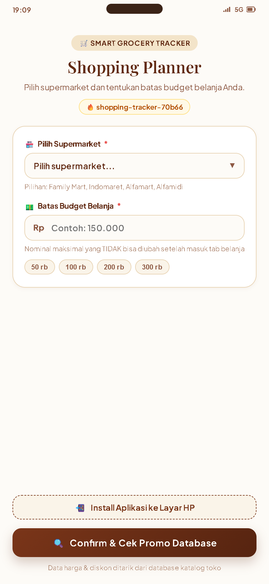
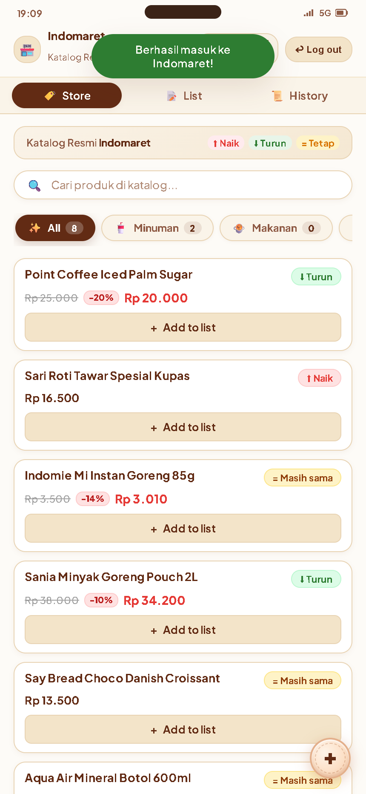
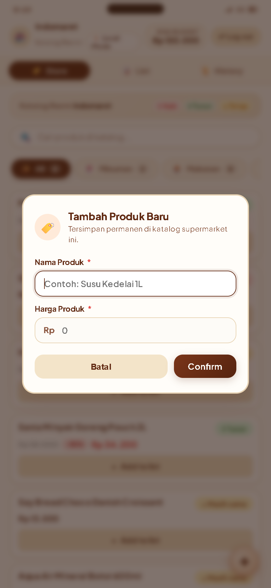
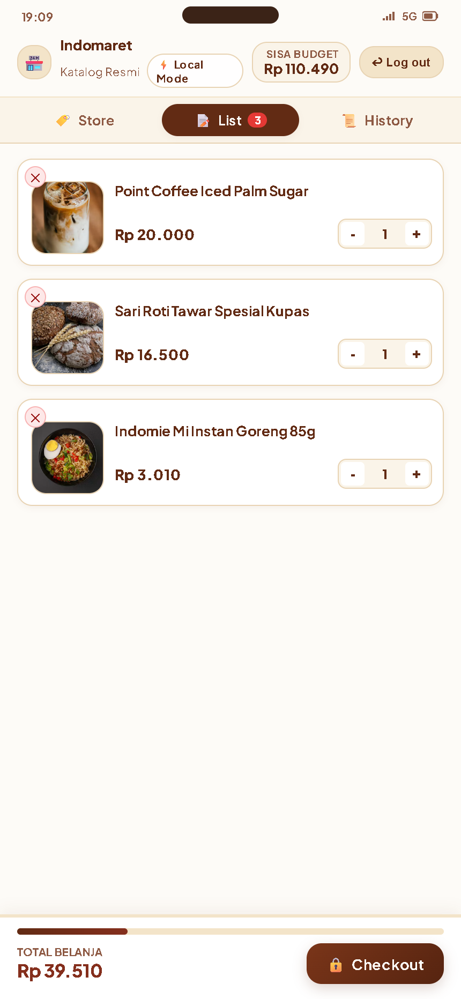
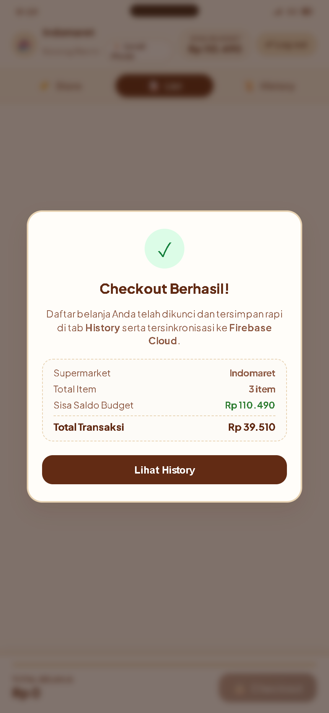
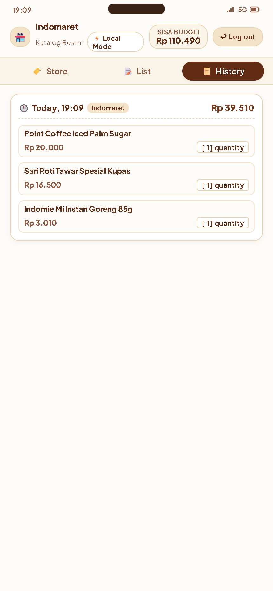

# DOKUMENTASI PROJECT & USER MANUAL PRODUK
### Shopping List Tracker - Grocery & Budget (Smart Grocery Tracker)
**Mata Pelajaran:** Informatika (DT ICT) &bull; Modul P18~P19 Practical Test (PT)  
**Sekolah:** SMA Mutiara Bangsa 2 Tangerang  

---

## Bagian 1 &bull; Identitas Project & Pembuat

| Atribut Identitas | Keterangan Lengkap |
| :--- | :--- |
| **Judul Dokumen** | Dokumentasi Project &bull; Shopping List Tracker - Grocery & Budget |
| **Nama Resmi Aplikasi** | Shopping List Tracker - Grocery & Budget (Smart Grocery Tracker) |
| **Nama Pembuat (Developer)** | **Rachel Allen Wu** (GitHub: [`ElisiaMint`](https://github.com/ElisiaMint)) |
| **Kelas / Nomor Absen** | Kelas 12 MIPA / IPS &bull; No. Absen: [Nomor Absen] |
| **Tautan Live Website (Hosting)** | [https://shopping-tracker-70b66.web.app](https://shopping-tracker-70b66.web.app) |
| **Tautan GitHub Repository** | [https://github.com/ElisiaMint/Smart-Grocery](https://github.com/ElisiaMint/Smart-Grocery) |
| **Akses Cepat (QR Code)** |  *(Scan dengan smartphone)* |

---

## Bagian 2 &bull; Tentang Aplikasi (Deskripsi & Manfaat)

### 2.1 Deskripsi Singkat
**Shopping List Tracker** adalah aplikasi perencana dan pencatat belanja supermarket berbasis *Progressive Web App (PWA)* dengan desain mobile modern bernuansa *Cream & Brown Aesthetic*. Aplikasi ini dirancang untuk mendampingi pengguna secara interaktif saat berbelanja di berbagai jaringan pasar swalayan Indonesia seperti **Lotte Mart, Family Mart, Indomaret, Alfamart,** dan **Alfamidi**.

### 2.2 Solusi Nyata & Manfaat
1. **Mencegah Overbudget & Impulsive Buying:** Pengguna menentukan batas anggaran sebelum berbelanja. Setiap kali barang ditambahkan ke daftar, sistem menghitung sisa anggaran secara *real-time* dan memblokir penambahan barang jika total biaya melebihi pagu anggaran.
2. **Indikator Tren Harga Bulan Lalu (*Price Trend Monitor*):** Setiap barang menampilkan label fluktuasi harga bulan lalu (**⬆ Naik**, **⬇ Turun**, atau **= Tetap**), memberikan pertimbangan objektif bagi pengguna untuk berhemat.
3. **Kalkulasi Diskon Akurat & Bertingkat:** Mendukung kalkulasi diskon tunggal maupun diskon kompound (*compound discount*, e.g. `-50% + 20%`).
4. **Dukungan Penuh Mode Offline:** Memanfaatkan *Service Worker* sehingga aplikasi tetap dapat diakses di area minim sinyal seperti basement gedung supermarket.

### 2.3 Target Pengguna
- **Ibu Rumah Tangga:** Untuk mengelola anggaran belanja bulanan keluarga.
- **Siswa & Mahasiswa:** Untuk mengatur pengeluaran uang saku secara disiplin dan terencana.
- **Masyarakat Umum / Smart Shopper:** Pemburu promo yang menginginkan catatan belanja praktis.

---

## Bagian 3 &bull; Penjelasan Fitur & Langkah Penggunaan

### 3.1 Fitur 1: Inisialisasi Toko & Batas Budget Belanja (Setup Screen)
- **Fungsi & Manfaat:** Mengunci supermarket sasaran dan batas modal belanja yang tidak dapat dimanipulasi selama sesi belanja aktif.
- **Screenshot Tampilan Asli:**  
  
- **Langkah Penggunaan (Step-by-Step):**
  1. Buka aplikasi pada browser atau ikon Home Screen ponsel.
  2. Pilih supermarket pada dropdown *Pilih Supermarket* (misal: *Indomaret* atau *Lotte Mart*).
  3. Masukkan nominal batas belanja pada kolom *Batas Budget Belanja* (atau gunakan chip praktis: 50 rb, 100 rb, 200 rb, 300 rb).
  4. Ketuk tombol **Confirm & Cek Promo Database**.

### 3.2 Fitur 2: Katalog Promo Supermarket & Tren Harga (Store Tab)
- **Fungsi & Manfaat:** Menjelajahi katalog resmi toko dengan label diskon coret, filter kategori, dan pencarian cepat.
- **Screenshot Tampilan Asli:**  
  
- **Langkah Penggunaan (Step-by-Step):**
  1. Pada tab **Store** (🏷️), telusuri produk yang diinginkan.
  2. Gunakan kolom *Search* untuk mencari barang secara spesifik.
  3. Manfaatkan chip kategori (*All, Minuman, Makanan, Alat Mandi*).
  4. Amati tren harga bulan lalu (hijau ⬇ Turun untuk harga promo terbaik).
  5. Ketuk tombol **+ Add to list** untuk memasukkan barang ke daftar belanja.

### 3.3 Fitur 3: Kancing Cepat Tambah Produk Kustom (Custom Product Modal)
- **Fungsi & Manfaat:** Menambahkan item barang kebutuhan pribadi yang belum terdaftar di katalog bawaan toko.
- **Screenshot Tampilan Asli:**  
  
- **Langkah Penggunaan (Step-by-Step):**
  1. Ketuk tombol bulat melayang berikon **+** di pojok kanan bawah tab Store.
  2. Masukkan nama barang pada kolom *Nama Produk*.
  3. Masukkan nominal estimasi pada kolom *Harga Produk*.
  4. Ketuk tombol **Confirm**. Produk baru akan tersimpan di katalog toko lokal.

### 3.4 Fitur 4: Keranjang Belanja Interaktif & Kunci Checkout (List Tab)
- **Fungsi & Manfaat:** Memantau akumulasi total harga, mengatur kuantitas barang, dan mengunci transaksi saat belanja usai.
- **Screenshot Tampilan Asli:**  
    
  *Struk Digital Checkout Sukses:*  
  
- **Langkah Penggunaan (Step-by-Step):**
  1. Masuk ke tab **List** (📝).
  2. Sesuaikan kuantitas barang menggunakan tombol `+` atau `-`.
  3. Pantau bilah visual progress bar anggaran dan sisa saldo belanja.
  4. Ketuk tombol **🔒 Checkout** di kasir untuk mengunci transaksi dan melihat struk digital.

### 3.5 Fitur 5: Riwayat Belanja & Sinkronisasi Cloud Firestore (History Tab)
- **Fungsi & Manfaat:** Mengarsipkan setiap transaksi secara kronologis dan otomatis menyinkronkannya ke *Google Cloud Firestore*.
- **Screenshot Tampilan Asli:**  
  
- **Langkah Penggunaan (Step-by-Step):**
  1. Buka tab **History** (📜).
  2. Periksa detail belanja masa lalu yang tersusun rapi berdasarkan tanggal dan jam belanja.
  3. Data tetap tersimpan aman di cloud meskipun cache perangkat dibersihkan.

---

## Bagian 4 &bull; Cara Membuka & Menjalankan Aplikasi

1. **Akses Web Browser Komputer (PC / Laptop):**  
   Buka peramban (Chrome, Edge, Safari) dan navigasikan ke `https://shopping-tracker-70b66.web.app`. Aplikasi akan tampil dalam bingkai smartphone 9:16 yang interaktif.
2. **Akses Smartphone (Mobile Browser):**  
   Buka tautan website pada browser seluler atau scan QR Code di atas. Desain otomatis responsif penuh satu layar.
3. **Instalasi Progressive Web App (PWA) ke Layar Utama:**  
   - **Android Chrome:** Ketuk tombol *"Install Aplikasi ke Layar HP"* pada aplikasi, atau pilih menu titik tiga &rarr; *Install app / Tambahkan ke Layar Utama*.
   - **iOS Safari (iPhone):** Ketuk ikon *Share* (kotak panah ke atas) &rarr; pilih *"Add to Home Screen"* &rarr; ketuk *Add*.

---

## Bagian 5 &bull; Tanya Jawab & Kendala Umum (FAQ)

| Kendala Teknis | Pertanyaan | Solusi Teknis |
| :--- | :--- | :--- |
| **Penyimpanan Data** | *Apakah daftar belanja hilang bila tab browser ditutup?* | **Aman.** Aplikasi menggunakan *dual-storage*: LocalStorage untuk sesi aktif realtime dan Google Firebase Cloud Firestore untuk riwayat checkout permanen. |
| **Validasi Input** | *Mengapa muncul animasi getar merah pada saldo budget?* | Sistem mendeteksi barang yang hendak dimasukkan melebihi sisa batas anggaran (*budget cap*). Kurangi kuantitas barang lain terlebih dahulu. |
| **Konektivitas** | *Dapatkah aplikasi dipakai di lantai basement supermarket tanpa sinyal?* | **Bisa.** Berkat Service Worker PWA, seluruh aplikasi berjalan penuh secara offline. Data tersimpan di memori lokal dan disinkronkan ke server saat kembali online. |

---

## Bagian 6 &bull; Rencana Fitur Tambahan (Wishlist)

1. **Otomasi Pemindaian Struk Belanja dengan Kamera (OCR & Google Gemini AI):** Deteksi otomatis nama barang dan harga langsung dari foto struk belanjaan fisik.
2. **Fitur Ekspor Laporan Finansial ke Format PDF / Excel:** Unduh ringkasan pengeluaran bulanan dalam bentuk dokumen PDF formal atau lembar kerja spreadsheet.
3. **Smart Pantry & Expiry Alert:** Pengingat otomatis masa kedaluwarsa bahan makanan yang telah dibeli beserta saran resep masakan cerdas.

---

## Nilai Tambah (Nilai A+) &bull; Tips Efisiensi Penggunaan
- **Utamakan Produk Berlabel ⬇ Turun:** Produk berlabel hijau menawarkan harga lebih ekonomis dibanding bulan sebelumnya.
- **Kunci Belanja via Checkout:** Selalu ketuk tombol *Checkout* sebelum keluar (*Log out*) agar histori transaksi tersimpan sempurna di cloud.
